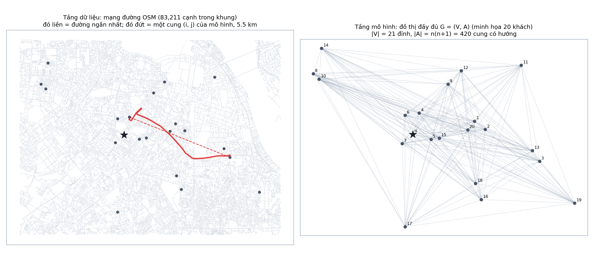
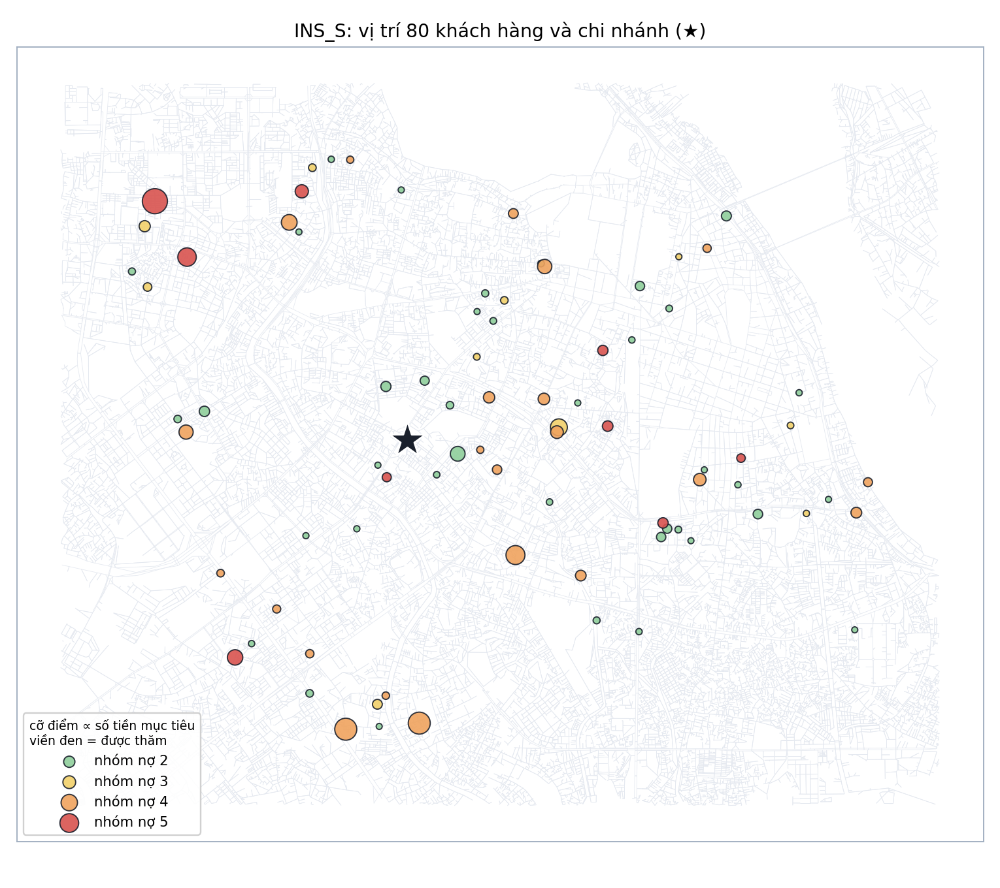
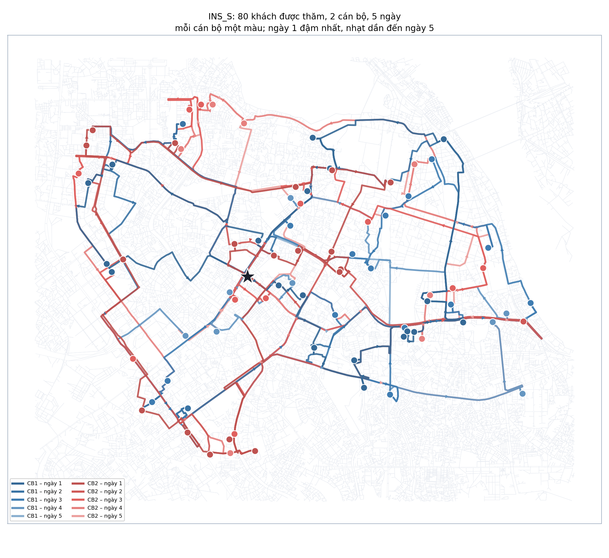

# Tổng quan: bài toán định tuyến thu hồi nợ nhiều ngày

Tài liệu này mô tả bài toán, dữ liệu và các hướng giải ở mức tổng quan. Chi
tiết nằm ở các tài liệu khác:

| Tài liệu | Nội dung |
|---|---|
| [01_mo_hinh_toan.md](01_mo_hinh_toan.md) | Ký hiệu, mô hình MILP (1)–(15), mục tiêu phụ, mô hình động |
| [02_bieu_dien_nghiem.md](02_bieu_dien_nghiem.md) | Biểu diễn nghiệm, phép biến đổi giữa MILP và heuristic |
| [03_phuong_phap_giai.md](03_phuong_phap_giai.md) | Branch-and-Cut, GA, Tabu Search, ALNS; cách đọc gap |
| [04_thuc_nghiem.md](04_thuc_nghiem.md) | Thiết kế thí nghiệm, bảng kết quả, hình vẽ, nhận xét |
| [de_xuat_de_tai.docx](de_xuat_de_tai.docx) | Đề xuất đề tài ban đầu |

## 1. Bài toán

Một chi nhánh ngân hàng có **K cán bộ thu hồi nợ** đi xe máy và **n khách hàng
quá hạn** trong một kỳ **H ngày làm việc**. Mỗi ngày, mỗi cán bộ xuất phát từ
chi nhánh, thăm một số khách rồi quay về, trong giới hạn **B phút** (di chuyển
cộng thời gian làm việc với khách).

Khi được thăm vào ngày t, khách i trả đủ số tiền mục tiêu w(i) với xác suất
p(i,t); nếu không trả thì thu được 0. Xác suất **giảm dần theo ngày**: để càng
muộn càng khó thu. Một khách có thể được thăm lại, tối đa m lần trong kỳ.

**Câu hỏi:** mỗi ngày, cán bộ nào thăm những khách nào và theo thứ tự nào, để
**tổng tiền thu hồi kỳ vọng** trong cả kỳ lớn nhất? Khi hai kế hoạch có cùng
giá trị kỳ vọng, chọn kế hoạch có tổng quãng đường nhỏ hơn.

Giá trị kỳ vọng của khách i khi được thăm vào tập ngày S là

$$
v(i,S)=w_i\Bigl[1-\prod_{t\in S}\bigl(1-p_{it}\bigr)\Bigr],
$$

tức w(i) nhân xác suất khách trả ở ít nhất một lần thăm. Hàm này không tuyến
tính theo các lần thăm, nên mô hình chọn trước **lịch thăm S** cho mỗi khách
(biến λ) với giá trị v(i,S) tính sẵn.

### Liên hệ với bài toán gốc của môn học

Bài toán gốc (Orange ROADEF 2026, T-Adaptive Segment Routing) giải nhiều
**chu kỳ thời gian liên kết với nhau**: Step 6 giải một chu kỳ, Step 9 giải
nhiều chu kỳ với ràng buộc nối giữa các chu kỳ. Đề tài này có cấu trúc tương ứng:

| Orange T-ASR | Đề tài thu hồi nợ |
|---|---|
| Step 6: một chu kỳ | **GD1**: một ngày (H = 1), mỗi khách tối đa 1 lần thăm |
| Step 9: nhiều chu kỳ liên kết | **GD2**: năm ngày (H = 5), lịch thăm λ nối các ngày qua ràng buộc (3) và giới hạn m lần thăm |
| Giới hạn thời gian 1800 s / 3600 s tỉ lệ theo số chu kỳ | 30 s / 150 s = 30 s × 5 ngày |

## 2. Đồ thị của bài toán

Bài toán dùng hai tầng đồ thị:

1. **Tầng dữ liệu:** mạng đường OSM của nội thành Hà Nội, 57.242 nút và
   130.220 cạnh có hướng (có đường một chiều, tốc độ theo loại đường).
2. **Tầng mô hình:** đồ thị đầy đủ có hướng G = (V, A) với
   |V| = n + 1 đỉnh (chi nhánh 0 và n khách) và |A| = n(n + 1) cung.
   Mỗi cung (i, j) mang quãng đường và thời gian của **đường đi ngắn nhất** từ
   i tới j trên tầng dữ liệu.

## 3. Dữ liệu

Bộ dữ liệu `collection_routing_dataset_v3/` (README riêng trong thư mục đó)
được dựng từ nguồn công khai và các giả định ghi rõ:

| Thành phần | Nguồn | Cố định hay chọn |
|---|---|---|
| Mạng đường, vị trí chi nhánh | OpenStreetMap | Cố định |
| Vị trí khách | Lấy mẫu theo dân số 27 phường | Cố định theo seed của từng bộ khách |
| Hồ sơ nhân khẩu | NVIDIA Nemotron Personas (Việt Nam) | Cố định |
| Hạn mức, tỷ lệ sử dụng thẻ | UCI Default of Credit Card (hình dạng phân bố) | Cố định |
| Khoản vay, nhóm nợ, số ngày quá hạn | Giả định (log-chuẩn, tỷ trọng theo nhóm 2–5) | Cố định |
| Xác suất p(i,t) | Giả định: h · p₀(nhóm) · (1 − 0,3·f(DPD)) · (1 − δ)^(t−1) | Chọn kịch bản h = 0,5 / 1 / 1,5 |
| Cán bộ, giờ làm việc | 4 cán bộ, 480 phút/ngày, kỳ 02–06/11/2026 | Chọn K, B |
| Số lần thăm tối đa m | Tham số mô hình | Chọn m |

Có 5 bộ khách: **MAIN** (500 khách) và **REP1–REP4** (200 khách mỗi bộ), mỗi bộ
sinh với một seed khác nhau. Các instance lồng nhau:
INS_XS (30) ⊂ INS_S (80) ⊂ INS_M (200) ⊂ INS_L (500) lấy từ MAIN;
REPk_S (80) ⊂ REPk_M (200) lấy từ bộ REPk.

**Chọn instance cho thí nghiệm** (chi tiết ở [04_thuc_nghiem.md](04_thuc_nghiem.md)):
cố định mọi tham số trừ số khách n (K = 2, B = 480 phút, m = 2, kịch bản p cơ
sở) và tăng n theo mốc 10, 20, 30, 50, 80 bằng cách lấy n khách đầu của instance
lồng nhau. Ở mốc 80 khách dùng thêm REP1–REP4 để kiểm tra kết quả không phụ
thuộc một bộ khách cụ thể.

## 4. Các hướng giải

### 4.1. Lập kế hoạch tĩnh (bài toán chính)

Giải **một lần** cho cả H ngày, tối đa hóa giá trị kỳ vọng:

| Phương pháp | Loại | Bảo đảm | File |
|---|---|---|---|
| Branch-and-Cut (HiGHS) | Chính xác | Có cận trên; chứng minh tối ưu khi kịp | [branch_and_cut.jl](../core/branch_and_cut.jl) |
| BnC khởi động ấm | Chính xác + heuristic | Bắt đầu từ nghiệm ALNS | như trên |
| Tabu Search | Metaheuristic | Không | [tabu_search.jl](../core/tabu_search.jl) |
| ALNS | Metaheuristic | Không | [alns.jl](../core/alns.jl) |
| Genetic Algorithm | Metaheuristic | Không | [genetic_algorithm.jl](../core/genetic_algorithm.jl) |

Ba metaheuristic dùng chung biểu diễn ma trận G(i,t) ∈ {0, 1, …, K} (khách i,
ngày t, cán bộ nào thăm), chung thủ tục dựng tuyến (nearest-neighbor + 2-opt) và
chung luật dừng: tối đa 300 vòng, dừng sớm sau 50 vòng liên tiếp không cải thiện.

### 4.2. Thực hiện trong môi trường ngẫu nhiên (mở rộng)

Kế hoạch tĩnh không dùng thông tin mới: khách đã trả ở ngày 1 vẫn nằm trong
lịch ngày 3. Ba chính sách được so sánh bằng mô phỏng Monte Carlo:

| Chính sách | Lập kế hoạch khi nào | Cho bao nhiêu ngày |
|---|---|---|
| Tĩnh | Một lần đầu kỳ | Cả H ngày |
| Cuốn chiếu (rolling horizon) | Đầu mỗi ngày, sau khi biết ai đã trả | Các ngày còn lại |
| Tham lam (myopic) | Đầu mỗi ngày | Chỉ ngày hôm đó |

Cả ba dùng ALNS làm bộ giải và cùng dãy số ngẫu nhiên trong mỗi kịch bản.

## 5. Kết quả chính

Tóm tắt; bảng đầy đủ ở [04_thuc_nghiem.md](04_thuc_nghiem.md).

- Đến 30 khách, Branch-and-Cut chứng minh tối ưu ở cả hai giai đoạn và mọi
  metaheuristic đều tìm đúng nghiệm tối ưu.
- Từ 50 khách, Branch-and-Cut hết giờ gần như ngay tại nút gốc, nghiệm tìm được
  rất kém (gap hàng trăm đến hàng chục nghìn %) dù cận trên khá chặt.
- Metaheuristic đạt gap 0,1–3,7% so với cận đó trong vài giây đến vài chục giây.
  ALNS cho gap nhỏ nhất ở GD2, Tabu nhanh nhất.
- Khởi động ấm Branch-and-Cut từ nghiệm ALNS giữ được chất lượng của ALNS nhưng
  không cải thiện thêm trong 150 s.

