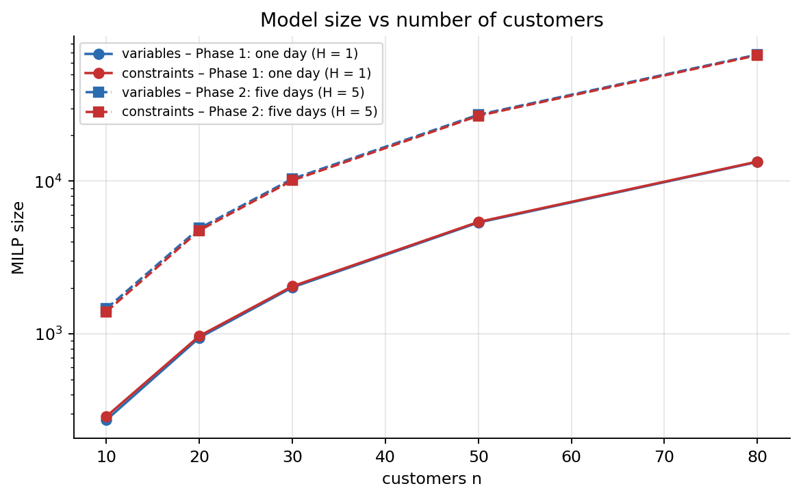
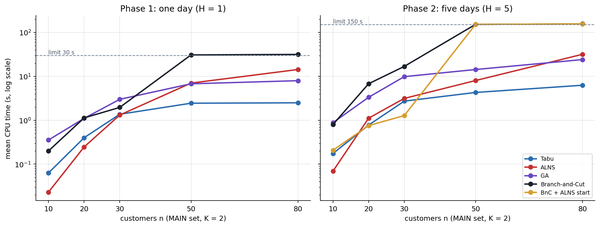
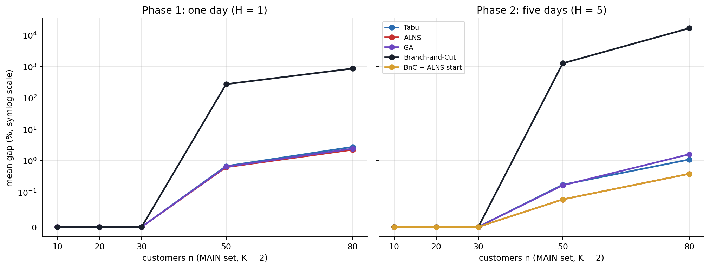
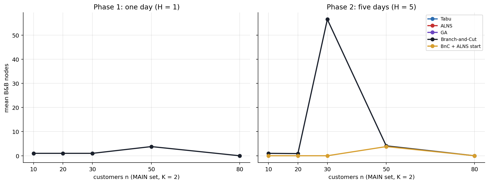
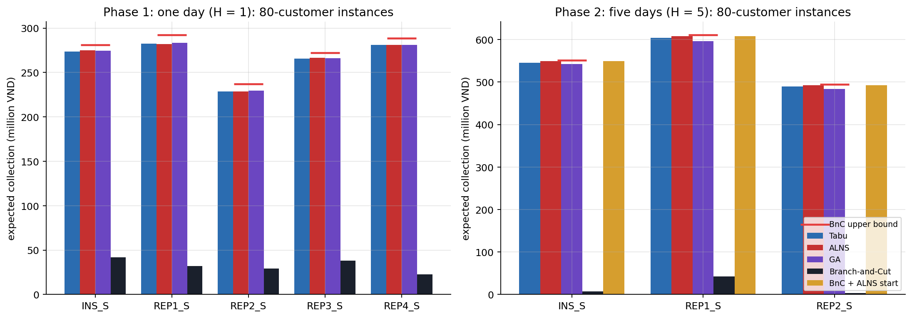
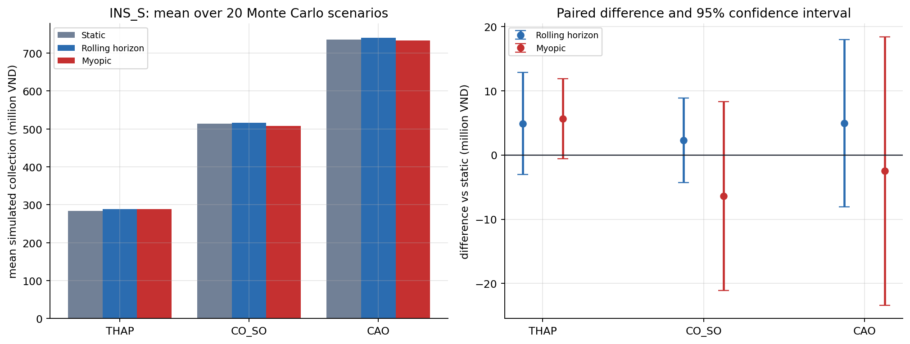
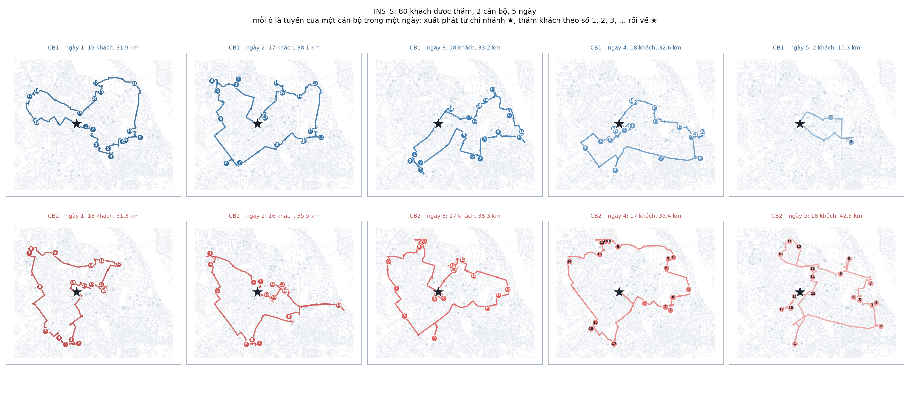
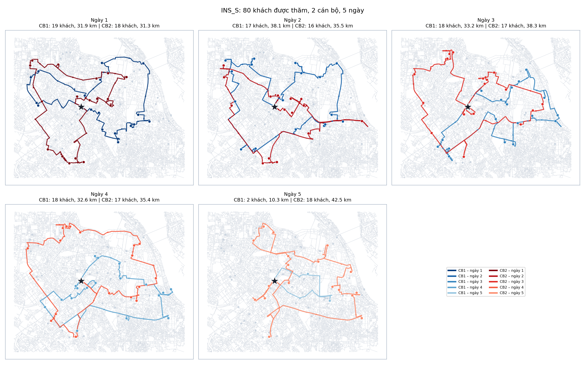
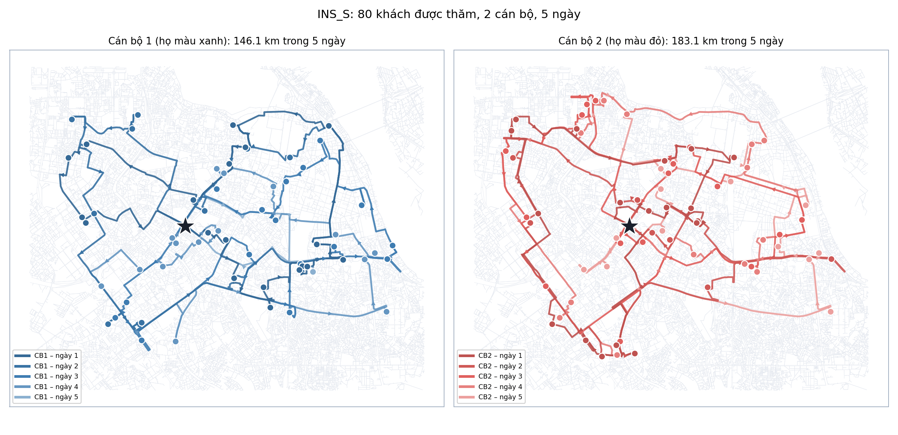
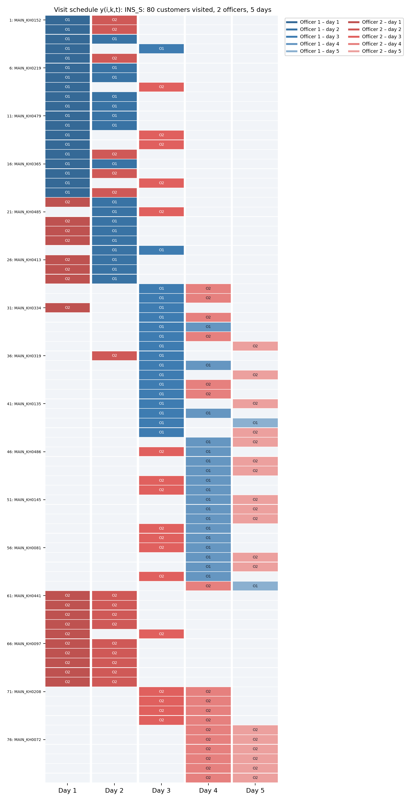

# Numerical experiments

Goal: measure the **CPU time, gap and number of Branch-and-Bound nodes** of the
methods as the problem size grows, for the one-day problem (Phase 1) and the
five-day problem (Phase 2). Each configuration is run **10 times** and the
results are averaged.

## 1. Environment

| Item | Value |
|---|---|
| Machine | Laptop, Intel Core i7-1165G7 (4 cores), Windows 10 |
| Language | Julia 1.13.2, JuMP, HiGHS (MIP, single thread) |
| Runner | [run_v3_experiments.jl](../core/run_v3_experiments.jl) |
| Configs | [v3_experiments_gd1.json](../configs/v3_experiments_gd1.json), [v3_experiments_gd2.json](../configs/v3_experiments_gd2.json) |
| Raw results | `outputs/experiments/v3_experiments_gd{1,2}/runs.csv`, `summary.csv`, `instances.csv` |

Phase 1 and Phase 2 run in parallel on two separate cores; HiGHS solves MIPs
almost single-threaded, so the two processes do not compete much for CPU.

## 2. Experimental design

### 2.1. Instances

The dataset offers many parameters (number of officers, minutes per day, m,
p-scenario). To isolate the effect of **size**, we fix all other parameters and
only increase the number of customers:

| Parameter | Fixed value | Reason |
|---|---|---|
| Number of officers K | 2 | Default of INS_XS and INS_S in the dataset |
| Working time B | 480 min/day | An 8-hour working day |
| Maximum visits m | 2 | Default of INS_S; used for every instance for a fair comparison |
| p-scenario | CO_SO (base, h = 1) | Base scenario |
| Number of days H | 1 (Phase 1), 5 (Phase 2) | Correspond to Step 6 / Step 9 of the reference problem |

The number of customers n takes the values **10, 20, 30, 50, 80**: the first n
customers of INS_XS (n ≤ 30) or INS_S (n = 50, 80). Because the instances are
nested, a small instance is a subset of a larger one, so changes in the results
are due to n only. The value 50 lies between 30 (BnC still solves it) and 80
(BnC no longer does). At n = 80 we also use REP1_S–REP4_S (Phase 1) and
REP1_S–REP2_S (Phase 2), generated with different seeds, to check that the
conclusions do not depend on one customer set.

### 2.2. Time limits

The reference problem uses 1800 s for one period and 3600 s for two periods,
i.e. **proportional to the number of periods**. We apply the same principle:
Phase 1 gets **30 s** for one day, Phase 2 gets **150 s = 30 s × 5 days**. The
limit is the same for every instance within a phase, so CPU times are
comparable across instances.

### 2.3. Methods and parameters

| Method | Parameters |
|---|---|
| Branch-and-Cut | HiGHS, `mip_rel_gap = 1e-4`, symmetry breaking (15), `random_seed` = run seed |
| BnC + ALNS start (Phase 2 only) | As above, with the ALNS solution as starting solution |
| Tabu Search | 300 iterations, 40 neighbours per iteration, tabu tenure 15 |
| ALNS | 300 iterations, 4 destroy operators, 2 repair operators, simulated annealing |
| GA | Population 80, 300 generations |

The three metaheuristics share **the same stopping rule**: at most 300
iterations/generations, stopping early after 50 consecutive iterations without
improving the best solution. Run r uses seed 2026 + r for every method.

### 2.4. Metrics

- **Mean value:** mean expected collection (million VND) over 10 runs.
- **Mean gap:** (UB* − value)/value, where UB* is the tightest Branch-and-Cut
  upper bound in the same run (see [03_solution_methods.md](03_solution_methods.md#9-reading-the-results)).
- **Mean CPU:** seconds, solving time only.
- **Mean nodes:** number of HiGHS Branch-and-Bound tree nodes.
- **Optimal:** number of runs out of 10 in which HiGHS proved optimality.
- **Mean km:** total distance of the returned plan.

### 2.5. Timing and distance

Before any timing, every method is run once on a five-customer instance so
that Julia's compilation time is not counted. CPU is the wall-clock time of
the solver call only. When HiGHS proves optimality, a second solve minimises
distance at the same expected collection (constraints (13)–(14)) with the same
time limit; its time is stored separately (`distance_solve_seconds`) and
`total_seconds` includes it.

### 2.6. Budget check

To make sure the 300/50 budget does not decide the ranking, Phase 2 on INS_S,
n = 80 is repeated with five times the budget (1500 iterations, 250 without
improvement): [v3_experiments_budget_x5.json](../configs/v3_experiments_budget_x5.json).

## 3. Instance sizes

### Phase 1: one day

| Instance | n | K | H | \|V\| | \|A\| | Variables | Constraints |
|---|---|---|---|---|---|---|---|
| INS_XS | 10 | 2 | 1 | 11 | 110 | 272 | 287 |
| INS_XS | 20 | 2 | 1 | 21 | 420 | 942 | 967 |
| INS_XS | 30 | 2 | 1 | 31 | 930 | 2,012 | 2,047 |
| INS_S | 50 | 2 | 1 | 51 | 2,550 | 5,352 | 5,407 |
| INS_S | 80 | 2 | 1 | 81 | 6,480 | 13,362 | 13,447 |
| REP1_S | 80 | 2 | 1 | 81 | 6,480 | 13,362 | 13,447 |
| REP2_S | 80 | 2 | 1 | 81 | 6,480 | 13,362 | 13,447 |
| REP3_S | 80 | 2 | 1 | 81 | 6,480 | 13,362 | 13,447 |
| REP4_S | 80 | 2 | 1 | 81 | 6,480 | 13,362 | 13,447 |

### Phase 2: five days

| Instance | n | K | H | \|V\| | \|A\| | Variables | Constraints |
|---|---|---|---|---|---|---|---|
| INS_XS | 10 | 2 | 5 | 11 | 110 | 1,460 | 1,395 |
| INS_XS | 20 | 2 | 5 | 21 | 420 | 4,910 | 4,755 |
| INS_XS | 30 | 2 | 5 | 31 | 930 | 10,360 | 10,115 |
| INS_S | 50 | 2 | 5 | 51 | 2,550 | 27,260 | 26,835 |
| INS_S | 80 | 2 | 5 | 81 | 6,480 | 67,610 | 66,915 |
| REP1_S | 80 | 2 | 5 | 81 | 6,480 | 67,610 | 66,915 |
| REP2_S | 80 | 2 | 5 | 81 | 6,480 | 67,610 | 66,915 |

The number of variables grows roughly as K·H·n² because of the arc variables
x(i,j,k,t). For the same n = 80, the five-day model is about 5 times larger
than the one-day model.



## 4. Phase 1 results: one day, 30 s limit

| Instance | n | Method | Mean value | Mean gap (%) | Mean CPU (s) | Mean nodes | Optimal | Mean km |
|---|---|---|---|---|---|---|---|---|
| INS_XS | 10 | Tabu | 62.26 | 0.00 | 0.06 | – | – | 29.7 |
| INS_XS | 10 | ALNS | 62.26 | 0.00 | 0.02 | – | – | 29.7 |
| INS_XS | 10 | GA | 62.26 | 0.00 | 0.35 | – | – | 30.1 |
| INS_XS | 10 | Branch-and-Cut | 62.26 | 0.00 | 0.20 | 1.0 | 10/10 | 29.7 |
| INS_XS | 20 | Tabu | 96.97 | 0.00 | 0.40 | – | – | 43.4 |
| INS_XS | 20 | ALNS | 96.97 | 0.00 | 0.25 | – | – | 43.1 |
| INS_XS | 20 | GA | 96.97 | 0.00 | 1.10 | – | – | 44.5 |
| INS_XS | 20 | Branch-and-Cut | 96.97 | 0.00 | 1.13 | 1.0 | 10/10 | 44.0 |
| INS_XS | 30 | Tabu | 139.18 | 0.00 | 1.37 | – | – | 53.0 |
| INS_XS | 30 | ALNS | 139.18 | 0.00 | 1.32 | – | – | 51.2 |
| INS_XS | 30 | GA | 139.18 | 0.00 | 3.00 | – | – | 53.3 |
| INS_XS | 30 | Branch-and-Cut | 139.18 | 0.00 | 1.96 | 1.0 | 10/10 | 62.6 |
| INS_S | 50 | Tabu | 200.84 | 0.67 | 2.44 | – | – | 66.2 |
| INS_S | 50 | ALNS | 200.94 | 0.62 | 7.03 | – | – | 64.2 |
| INS_S | 50 | GA | 200.90 | 0.64 | 6.77 | – | – | 64.8 |
| INS_S | 50 | Branch-and-Cut | 68.39 | 273.14 | 30.80 | 3.8 | 0/10 | 33.6 |
| INS_S | 80 | Tabu | 273.43 | 2.74 | 2.50 | – | – | 68.9 |
| INS_S | 80 | ALNS | 274.81 | 2.22 | 14.32 | – | – | 63.6 |
| INS_S | 80 | GA | 274.32 | 2.40 | 7.97 | – | – | 65.5 |
| INS_S | 80 | Branch-and-Cut | 41.79 | 862.02 | 31.60 | 0.0 | 0/10 | 21.1 |
| REP1_S | 80 | Tabu | 282.27 | 3.63 | 2.22 | – | – | 63.6 |
| REP1_S | 80 | ALNS | 282.14 | 3.68 | 14.07 | – | – | 61.7 |
| REP1_S | 80 | GA | 283.22 | 3.28 | 7.75 | – | – | 60.4 |
| REP1_S | 80 | Branch-and-Cut | 31.90 | 2,518.66 | 31.64 | 0.0 | 0/10 | 17.3 |
| REP2_S | 80 | Tabu | 228.79 | 3.71 | 2.86 | – | – | 64.1 |
| REP2_S | 80 | ALNS | 228.82 | 3.70 | 16.20 | – | – | 63.1 |
| REP2_S | 80 | GA | 229.67 | 3.31 | 8.92 | – | – | 61.9 |
| REP2_S | 80 | Branch-and-Cut | 29.26 | 1,111.78 | 31.84 | 0.0 | 0/10 | 24.7 |
| REP3_S | 80 | Tabu | 265.45 | 2.57 | 2.11 | – | – | 69.1 |
| REP3_S | 80 | ALNS | 266.35 | 2.23 | 17.50 | – | – | 66.4 |
| REP3_S | 80 | GA | 266.23 | 2.27 | 8.08 | – | – | 67.0 |
| REP3_S | 80 | Branch-and-Cut | 38.24 | 24,331.10 | 31.61 | 0.0 | 0/10 | 26.8 |
| REP4_S | 80 | Tabu | 280.93 | 2.73 | 2.47 | – | – | 56.6 |
| REP4_S | 80 | ALNS | 281.01 | 2.70 | 15.33 | – | – | 56.5 |
| REP4_S | 80 | GA | 281.01 | 2.70 | 5.99 | – | – | 55.1 |
| REP4_S | 80 | Branch-and-Cut | 22.70 | 5,911.10 | 31.73 | 0.0 | 0/10 | 11.2 |

## 5. Phase 2 results: five days, 150 s limit

| Instance | n | Method | Mean value | Mean gap (%) | Mean CPU (s) | Mean nodes | Optimal | Mean km |
|---|---|---|---|---|---|---|---|---|
| INS_XS | 10 | Tabu | 109.92 | 0.00 | 0.17 | – | – | 59.5 |
| INS_XS | 10 | ALNS | 109.92 | 0.00 | 0.07 | – | – | 59.5 |
| INS_XS | 10 | GA | 109.92 | 0.00 | 0.88 | – | – | 60.7 |
| INS_XS | 10 | Branch-and-Cut | 109.92 | 0.00 | 0.80 | 1.0 | 10/10 | 59.5 |
| INS_XS | 10 | BnC + ALNS start | 109.92 | 0.00 | 0.21 | 0.0 | 10/10 | 59.5 |
| INS_XS | 20 | Tabu | 168.77 | 0.00 | 0.78 | – | – | 89.6 |
| INS_XS | 20 | ALNS | 168.77 | 0.00 | 1.11 | – | – | 86.2 |
| INS_XS | 20 | GA | 168.77 | 0.00 | 3.33 | – | – | 88.8 |
| INS_XS | 20 | Branch-and-Cut | 168.77 | 0.00 | 6.79 | 0.9 | 10/10 | 91.9 |
| INS_XS | 20 | BnC + ALNS start | 168.77 | 0.00 | 0.75 | 0.0 | 10/10 | 86.1 |
| INS_XS | 30 | Tabu | 246.80 | 0.00 | 2.72 | – | – | 111.5 |
| INS_XS | 30 | ALNS | 246.80 | 0.00 | 3.14 | – | – | 103.2 |
| INS_XS | 30 | GA | 246.80 | 0.00 | 9.85 | – | – | 107.1 |
| INS_XS | 30 | Branch-and-Cut | 246.80 | 0.00 | 16.85 | 56.5 | 10/10 | 144.0 |
| INS_XS | 30 | BnC + ALNS start | 246.80 | 0.00 | 1.28 | 0.0 | 10/10 | 103.2 |
| INS_S | 50 | Tabu | 361.56 | 0.17 | 4.30 | – | – | 238.7 |
| INS_S | 50 | ALNS | 361.90 | 0.08 | 8.03 | – | – | 216.6 |
| INS_S | 50 | GA | 361.59 | 0.16 | 14.31 | – | – | 266.6 |
| INS_S | 50 | Branch-and-Cut | 35.82 | 1,264.36 | 152.78 | 4.1 | 0/10 | 55.5 |
| INS_S | 50 | BnC + ALNS start | 361.90 | 0.08 | 152.83 | 3.8 | 0/10 | 216.6 |
| INS_S | 80 | Tabu | 545.20 | 1.09 | 6.27 | – | – | 352.1 |
| INS_S | 80 | ALNS | 549.03 | 0.38 | 31.79 | – | – | 329.1 |
| INS_S | 80 | GA | 542.49 | 1.59 | 24.12 | – | – | 336.0 |
| INS_S | 80 | Branch-and-Cut | 6.99 | 16,594.40 | 156.64 | 0.0 | 0/10 | 4.2 |
| INS_S | 80 | BnC + ALNS start | 549.03 | 0.38 | 156.53 | 0.0 | 0/10 | 329.1 |
| REP1_S | 80 | Tabu | 604.09 | 1.18 | 6.37 | – | – | 339.0 |
| REP1_S | 80 | ALNS | 608.27 | 0.49 | 34.53 | – | – | 304.4 |
| REP1_S | 80 | GA | 595.97 | 2.56 | 24.12 | – | – | 329.7 |
| REP1_S | 80 | Branch-and-Cut | 42.26 | 41,049.20 | 156.58 | 0.0 | 0/10 | 39.9 |
| REP1_S | 80 | BnC + ALNS start | 608.27 | 0.49 | 156.37 | 0.0 | 0/10 | 304.4 |
| REP2_S | 80 | Tabu | 489.51 | 1.01 | 6.75 | – | – | 342.9 |
| REP2_S | 80 | ALNS | 492.25 | 0.45 | 41.75 | – | – | 307.8 |
| REP2_S | 80 | GA | 483.75 | 2.21 | 24.90 | – | – | 337.3 |
| REP2_S | 80 | Branch-and-Cut | 2.96 | 14,769.40 | 156.64 | 0.0 | 0/10 | 10.2 |
| REP2_S | 80 | BnC + ALNS start | 492.25 | 0.45 | 156.46 | 0.0 | 0/10 | 307.8 |

### Budget check (INS_S, n = 80, Phase 2)

| Method | Gap 300/50 | Gap 1500/250 | CPU 300/50 (s) | CPU 1500/250 (s) | km 300/50 | km 1500/250 |
|---|---|---|---|---|---|---|
| Tabu | 1.09 | 1.00 | 6.3 | 32.5 | 352.1 | 352.9 |
| ALNS | 0.38 | 0.33 | 31.8 | 237.8 | 329.1 | 312.8 |
| GA | 1.59 | 0.87 | 24.1 | 180.9 | 336.0 | 349.8 |

## 6. Charts









## 7. Discussion

1. **Small instances (n ≤ 30).** Branch-and-Cut proves optimality in 10/10 runs
   in both phases; Tabu, ALNS and GA all find the optimal value. The one-day
   problem is solved at the root node; the five-day problem with 30 customers
   needs about 56 nodes and 17 s, so linking the days makes the problem much
   harder for the same number of customers.
2. **Distance.** The second (distance) solve of HiGHS hits its time limit at
   n = 20 and n = 30, so the cold HiGHS plan is longer than the ALNS plan with
   the same value (62.6 vs 51.2 km in Phase 1, 144.0 vs 103.2 km in Phase 2 at
   n = 30). For n ≥ 50 the cold HiGHS plan is short only because it visits few
   customers.
3. **Difficulty threshold (n = 50).** Branch-and-Cut hits the time limit in
   both phases after about 4 nodes: HiGHS spends almost all its time at the
   root node without finding a good integer solution. The bound is already
   tight (the heuristics are within 0.1–0.7%), but the BnC solution is poor.
4. **Large instances (n = 80).** Branch-and-Cut does not leave the root node,
   and its value is only about 1–15% of the metaheuristics'. The
   metaheuristics reach gaps of 2.2–3.7% in Phase 1 and 0.4–2.6% in Phase 2,
   on INS_S and on the REP sets alike.
5. **Comparing the metaheuristics.** In Phase 2, ALNS has the smallest gap
   (0.08–0.49%), the smallest spread and the shortest routes; Tabu is the
   fastest (4–7 s) with a gap of about 1%; GA is slower and worse at n = 80.
   In Phase 1 the three methods are within about 0.5 points.
6. **Budget.** With five times the iterations, GA improves most (1.59% →
   0.87%) and passes Tabu; ALNS and Tabu gain less than 0.1 point for 5–7.5
   times the time. ALNS stays best, so 300/50 is enough for the comparison.
7. **Warm start.** BnC + ALNS start has exactly the gap of ALNS for n ≥ 50:
   HiGHS finds nothing better within 150 s. At n = 30 it cuts the solve time
   from 16.8 s to 1.3 s.
8. **The heuristic gap is conservative.** When BnC is not optimal, UB* may
   still be loose, so the heuristics may be closer to the optimum than the gap
   suggests.

## 8. Extension: static, rolling horizon and myopic

Config: [v3_static_vs_rolling_report.json](../configs/v3_static_vs_rolling_report.json),
runner [run_v3_static_vs_rolling.jl](../core/run_v3_static_vs_rolling.jl).
Instance INS_S (80 customers, 2 officers, 5 days, m = 2), 20 Monte Carlo
scenarios per p-scenario, the same random numbers across policies. The routing
methods are picked automatically from the Phase 2 results at n = 80
(`"methods": ["best", "fastest"]`): **ALNS** (smallest gap) and **Tabu**
(smallest CPU). The static plan and every daily re-solve use the same
300/50 stopping rule. Results in `outputs/v3_INS_S/static_vs_rolling/`:

| File | Contents |
|---|---|
| `runs.csv` | One row per method and Monte Carlo scenario: collection, distance, visits and seconds of each policy |
| `policy_summary.csv` | Per policy and metric: mean, sd, se, 95% CI, min, quartiles, max |
| `paired_summary.csv` | Rolling horizon and myopic, each paired against static |
| `pairwise_comparison.csv` | Every pair of policies, including rolling horizon vs myopic |

The statistics can be recomputed from `runs.csv` without rerunning:
`julia --project=. core/run_v3_static_vs_rolling.jl --summarize outputs/v3_INS_S/static_vs_rolling`.

**Mean actual collection** (million VND, 20 scenarios; planned expectation of
the static plan in the last column):

| p-scenario | Method | Static | Rolling horizon | Myopic | Static, planned E |
|---|---|---|---|---|---|
| THAP | ALNS | 283.51 | 288.41 | 289.18 | 287.94 |
| THAP | Tabu | 274.71 | 284.43 | 289.05 | 286.08 |
| CO_SO | ALNS | 514.38 | 516.67 | 507.99 | 549.49 |
| CO_SO | Tabu | 490.49 | 494.88 | 510.41 | 544.76 |
| CAO | ALNS | 735.90 | 740.83 | 733.40 | 783.45 |
| CAO | Tabu | 687.06 | 699.59 | 734.72 | 776.57 |

**Paired differences** (policy − static; 95% CI; number of scenarios where the
policy is better out of 20):

| p-scenario | Method | Policy | Collection (million VND) | Distance (km) |
|---|---|---|---|---|
| THAP | ALNS | Rolling horizon | +4.90 (+1.7%) [−3.04; 12.84], 14/20 | −15.86 (−4.9%) [−20.76; −10.96], 19/20 |
| THAP | ALNS | Myopic | +5.66 (+2.0%) [−0.57; 11.90], 12/20 | −38.11 (−11.8%) [−41.31; −34.91], 20/20 |
| THAP | Tabu | Rolling horizon | +9.72 (+3.5%) [−0.30; 19.75], 10/20 | −20.89 (−5.9%) [−24.56; −17.23], 20/20 |
| THAP | Tabu | Myopic | +14.34 (+5.2%) [−2.26; 30.95], 11/20 | −60.48 (−17.0%) [−64.04; −56.92], 20/20 |
| CO_SO | ALNS | Rolling horizon | +2.28 (+0.4%) [−4.28; 8.84], 12/20 | −27.70 (−8.8%) [−31.93; −23.46], 20/20 |
| CO_SO | ALNS | Myopic | −6.40 (−1.2%) [−21.09; 8.30], 9/20 | −54.39 (−17.2%) [−57.84; −50.95], 20/20 |
| CO_SO | Tabu | Rolling horizon | +4.39 (+0.9%) [−13.18; 21.95], 11/20 | −20.02 (−5.9%) [−24.30; −15.73], 20/20 |
| CO_SO | Tabu | Myopic | +19.92 (+4.1%) [3.69; 36.15], 16/20 | −56.52 (−16.6%) [−60.97; −52.06], 20/20 |
| CAO | ALNS | Rolling horizon | +4.93 (+0.7%) [−8.09; 17.95], 11/20 | −25.04 (−8.1%) [−30.38; −19.70], 20/20 |
| CAO | ALNS | Myopic | −2.50 (−0.3%) [−23.37; 18.37], 9/20 | −50.83 (−16.4%) [−54.85; −46.80], 20/20 |
| CAO | Tabu | Rolling horizon | +12.53 (+1.8%) [−13.35; 38.40], 11/20 | −23.27 (−6.8%) [−25.58; −20.95], 20/20 |
| CAO | Tabu | Myopic | +47.66 (+6.9%) [20.93; 74.39], 16/20 | −66.34 (−19.5%) [−70.07; −62.61], 20/20 |



**Discussion.**

1. **With ALNS: no significant difference in collection.** The rolling horizon
   collects 0.4–1.7% more than static in every p-scenario, but every 95%
   interval contains 0. The 100-scenario config (`v3_static_vs_rolling.json`)
   is needed for a firm conclusion.
2. **Distance: a clear gain.** Re-planning drops repeat visits to customers who
   have already paid: 5–9% less travel for the rolling horizon and 12–19% for
   myopic, with every interval below 0.
3. **With Tabu, re-planning matters more.** The static Tabu plan collects 3–7%
   less than the static ALNS plan. Myopic re-planning recovers this and is
   significantly better than static under CO_SO (+19.9) and CAO (+47.7, 16/20
   scenarios each), ending at the level of the ALNS policies. The one-day
   problems of the myopic policy are small, where Tabu is near the optimum.
4. **Why the rolling horizon is not clearly best.** Each re-solve maximises the
   expectation as if no further re-planning will happen, so it is not the
   optimal dynamic policy, and the variation between heuristic solves is about
   the size of the re-planning gain on INS_S.

Reference results from the dataset (sample Python script, 100 scenarios,
static and rolling horizon only;
`collection_routing_dataset_v3/ket_qua/BAO_CAO_MO_PHONG.md`): on INS_S, the
rolling horizon differs from static by −0.2% (THAP, low), +0.3% (CO_SO, base),
+0.7% (CAO, high); on INS_L by +1.6%, +3.6%, +4.1% respectively. The benefit of
re-planning grows when repayment probabilities are high and when there are many
customers.

## 9. Plan illustrations

Five-day plan of INS_S (ALNS). Each officer has one colour family; day 1 is
darkest and the colour fades towards day 5.









## 10. Reproduction

```powershell
# Main tables (about 6 hours, Phase 1 and Phase 2 in parallel)
powershell -ExecutionPolicy Bypass -File scripts\run_experiments.ps1
# Budget check (about 2.5 hours)
& "D:\julia-1.13.2\bin\julia.exe" --project=. core/run_v3_experiments.jl configs/v3_experiments_budget_x5.json
# Compare the three policies, ALNS + Tabu (about 2.5 hours)
& "D:\julia-1.13.2\bin\julia.exe" --project=. core/run_v3_static_vs_rolling.jl configs/v3_static_vs_rolling_report.json
# Figures
python core/plot_results.py
python core/plot_v3_plan.py
```
